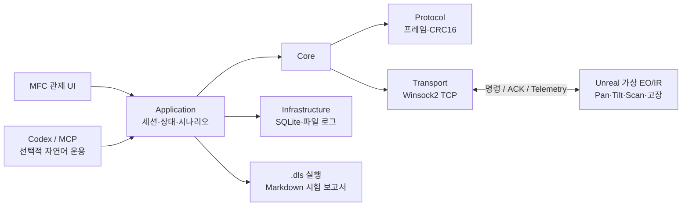

# DeviceLink Studio

> Windows C++20 · MFC · Unreal Engine 5.8 · TCP · SQLite
> **가상 EO/IR 장비의 운용, 통신 장애 복구, 자동 시험을 한 흐름으로 검증하는 SILS-like 테스트베드**

Unreal Engine이 고정형 EO/IR 짐벌과 고장 상황을 재현하고, MFC 관제 콘솔이 장비 명령·상태 감시·시험을 수행합니다. 목표는 실제 광학 성능의 재현보다 **장비 통신과 상태 전이, 멀티스레드 처리, 복구 절차의 검증**입니다.

## 핵심 흐름

**연결 → 전원·초기화·각도/스캔 제어 → 장애 주입 → 알람·이력 확인 → 재접속·복구 → 보고서 생성**

## 핵심 기능

- **안정적인 통신:** TCP 송수신 worker, 송신 큐, 연결 timeout, 자동 재접속과 안전 종료. Transport는 raw byte만 다루고 Protocol이 프레임·CRC16·스트림 파싱을 담당합니다.
- **장비 관제:** 전원·초기화·Pan/Tilt·Scan 명령, ACK/Telemetry와 상태·온도·전압·통신 품질 표시. worker 이벤트는 큐와 `PostMessage`를 거쳐 UI 스레드에서 처리합니다.
- **장애와 복구:** Motor Stall·과열·센서 고장·응답 지연·무응답 주입, heartbeat Warning/Fault, SQLite 알람 이력 및 정상화 확인.
- **반복 검증:** `.dls` 시나리오, Record & Replay, 단계별 PASS/FAIL Markdown 보고서, Transport 및 Unreal 통합 Soak 테스트.

## 프로젝트 구조

| 경로 | 역할 |
| --- | --- |
| `src/`, `include/DeviceLink/` | UI → Application → Core; 독립된 Protocol·Transport와 Infrastructure 구현 |
| `UnrealVirtualDevice/` | EO/IR 가상 장비, TCP 서버, 짐벌 상태 머신과 현장 레벨 |
| `mcp_server/`, `src/AgentBridge/` | 선택적 자연어 장비 운용; 기존 Application API 경유 |
| `scenarios/`, `tests/`, `docs/` | 자동 시험 시나리오·회귀 테스트·설계/운용 문서 |

## 실행과 검증

Windows에서 Visual Studio C++/MFC와 Unreal Engine 5.8을 준비한 뒤 `run-integration-demo.bat`를 실행합니다. 기본 연결은 `127.0.0.1:5000`입니다. C++ 테스트는 빌드 후 `ctest --test-dir build --output-on-failure`로 실행합니다.

주력 검증 대상은 **DeviceLink TCP로 연결된 고정형 EO/IR**입니다. 드론 운용은 같은 구조의 확장 사례이며, Axis VAPIX는 HTTP 요청·응답 매핑의 단위 검증 범위입니다.

[아키텍처](docs/ARCHITECTURE.md) · [시험 절차](docs/TESTING_KR.md) · [MCP 운용](docs/DEVICE_AGENT_MCP_KR.md) · [Unreal 가상 장비](docs/UNREAL_VIRTUAL_DEVICE.md)
