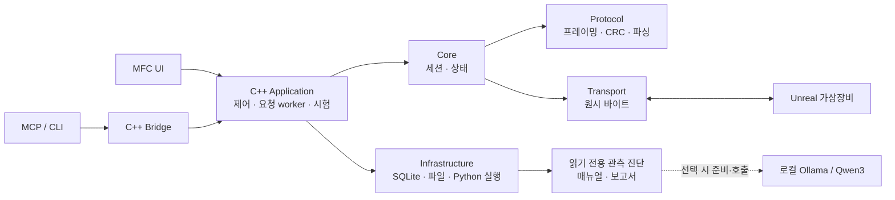
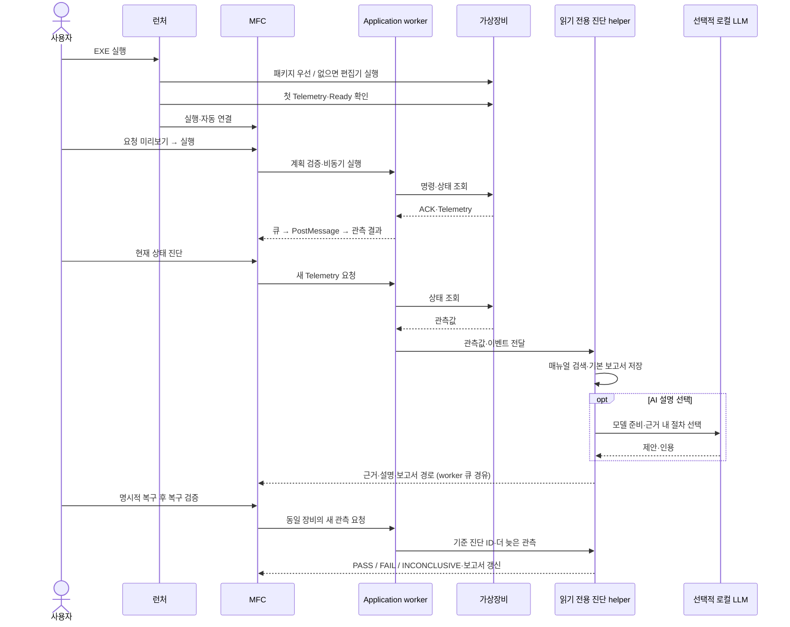

# DeviceLink Studio

**Windows C++20 · MFC · Unreal Engine 5.8 · TCP · SQLite**

가상 EO/IR 장비를 제어하고 통신 장애·고장 복구·자동 시험을 검증하는 SILS-like 테스트베드입니다. 통신 설계, 상태 전이, 멀티스레드와 시험 자동화를 중심으로 구현합니다.

## 기능

- 전원·초기화·Pan/Tilt·Scan 제어, Telemetry 및 Heartbeat 감시
- 프레임·CRC16·송수신 큐·자동 재접속, 고장·지연·무응답 주입
- 시나리오·Record & Replay, SQLite 이력·알람 및 PASS/FAIL 보고서
- MFC 운용/시험/이력 탭, 제한된 자연어의 미리보기·실행·중지
- MFC 진단·매뉴얼 인용·JSON/Markdown 보고서·복구 검증, 선택적 로컬 AI 설명

## 실행

준비된 이 PC에서는 루트의 **`DeviceLinkDemo.exe`**를 실행합니다.

1. 3D 화면 여부를 선택하고 시범운영을 시작합니다. 기본 시작에는 LLM이 필요하지 않습니다.
2. MFC에서 조작하거나 `Pan 30 Tilt -10`을 **미리보기 → 실행**합니다.
3. **현재 상태 진단**으로 근거·보고서를 확인합니다. AI가 필요하면 **AI 설명 추가**를 선택합니다.
4. 명시적으로 복구한 뒤 **복구 검증**으로 동일 장비의 더 늦은 상태를 확인합니다.
5. **최근 보고서 / 보고서 선택**으로 저장 파일을 열고, 런처에서 시범운영을 종료합니다.

로그·보고서는 `artifacts/demo/`에 저장됩니다. AI는 샘플 매뉴얼의 절차를 선택·설명하며 장비를 조작하지 않습니다. PASS는 관측 상태의 복구를 뜻합니다.

## 구조도



MFC는 기존 장비 세션의 관측값을 Python helper에 전달합니다. worker 결과는 큐와 `PostMessage`를 거쳐 UI 스레드에 표시됩니다.

## 작업 절차



## 최초 준비 / 재빌드

Windows x64, Visual Studio C++/MFC·Windows SDK·CMake/Ninja, Python 3.11 이상이 필요합니다. 편집기 실행·가상장비 패키징에는 Unreal Engine 5.8이 필요합니다.

```powershell
python -m venv mcp_server/.venv
.\mcp_server\.venv\Scripts\python.exe -m pip install -r mcp_server/requirements-diagnostics.txt
.\scripts\Build-DemoLauncher.ps1
# AI 설명을 사용할 때만 설치
.\scripts\Setup-LocalDiagnosticLlm.ps1
```

패키징 경로는 `artifacts/package/Windows/UnrealVirtualDevice.exe`이며 `DEVICELINK_UNREAL_PACKAGE`로 지정할 수도 있습니다. **루트 EXE는 프로젝트의 Python·빌드 결과 등을 사용하는 런처이며 단독 배포본이 아닙니다.**

[Unreal 준비](docs/UNREAL_VIRTUAL_DEVICE.md) · [로컬 LLM](docs/LOCAL_LLM_SETUP_KR.md) · [자산 조사·패키징](docs/UNREAL_LIGHTWEIGHT_DEPLOYMENT_KR.md)

## 검증과 남은 작업

2026-10-20: **C++ 6개·Python 49개 회귀 시험 통과**. MFC→Python의 실제 프로세스 호출·인용 보고서·복구 검증을 확인했습니다. 편집기 없는 최소 패키지의 연결·고장 진단·FAIL→PASS·종료도 통과했습니다. 실제 MFC 화면의 AI 응답 완료·DPI·키보드 탐색 검증은 남아 있습니다.

```powershell
ctest --test-dir build-demo --output-on-failure
.\mcp_server\.venv\Scripts\python.exe -m unittest tests.SnapshotDiagnosticTests tests.DeviceAgentMcpTests tests.DiagnosticAgentIntegrationTests tests.DemoLauncherTests
# 준비된 가상장비에서 실제 고장 주입·해제를 수행하는 모델 없는 통합 시연
.\mcp_server\.venv\Scripts\python.exe mcp_server/demo_launcher.py --smoke-basic
```

별도 최소 맵·패키지를 생성했으며 원본 자산은 보존했습니다. 추가 배포 검증·자산 정리·LangChain 의존성 단순화는 [개선 계획](docs/SIMPLIFICATION_MFC_INTEGRATION_PLAN_KR.md)에서 추적합니다. 모델·가상환경·실행 파일·개인 설정·생성 보고서는 Git에 포함하지 않습니다.

[아키텍처](docs/ARCHITECTURE.md) · [시험 절차](docs/TESTING_KR.md) · [MCP 운용](docs/DEVICE_AGENT_MCP_KR.md)
