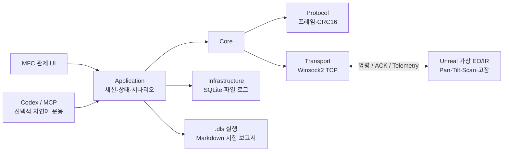

# DeviceLink Studio

> Windows C++20 · MFC · Unreal Engine 5.8 · TCP · SQLite
> **가상 EO/IR 장비의 운용, 통신 장애 복구, 자동 시험을 한 흐름으로 검증하는 SILS-like 테스트베드**

Unreal Engine이 고정형 EO/IR 짐벌과 고장 상황을 재현하고, MFC 관제 콘솔이 장비 명령·상태 감시·시험을 수행합니다. 목표는 실제 광학 성능의 재현보다 **장비 통신과 상태 전이, 멀티스레드 처리, 복구 절차의 검증**입니다.

## 핵심 흐름



**연결 → 전원·초기화·각도/스캔 제어 → 장애 주입 → 알람·이력 확인 → 재접속·복구 → 보고서 생성**

## 핵심 기능

- **안정적인 통신:** TCP 송수신 worker, 송신 큐, 연결 timeout, 자동 재접속과 안전 종료. Transport는 raw byte만 다루고 Protocol이 프레임·CRC16·스트림 파싱을 담당합니다.
- **장비 관제:** 전원·초기화·Pan/Tilt·Scan 명령, ACK/Telemetry와 상태·온도·전압·통신 품질 표시. worker 이벤트는 큐와 `PostMessage`를 거쳐 UI 스레드에서 처리합니다.
- **장애와 복구:** Motor Stall·과열·센서 고장·응답 지연·무응답 주입, heartbeat Warning/Fault, SQLite 알람 이력 및 정상화 확인.
- **반복 검증:** `.dls` 시나리오, Record & Replay, 단계별 PASS/FAIL Markdown 보고서, Transport 및 Unreal 통합 Soak 테스트.
- **로컬 AI 진단:** Ollama + Qwen3 4B로 최신 Telemetry·이벤트·샘플 매뉴얼을 묶어 진단하고, 근거가 있는 한국어 절차를 제안합니다. 복구 결과는 새 Telemetry로 판정하며 진단·검증 보고서를 저장합니다.

## 프로젝트 구조

| 경로 | 역할 |
| --- | --- |
| `src/`, `include/DeviceLink/` | UI → Application → Core; 독립된 Protocol·Transport와 Infrastructure 구현 |
| `UnrealVirtualDevice/` | EO/IR 가상 장비, TCP 서버, 짐벌 상태 머신과 현장 레벨 |
| `mcp_server/`, `src/AgentBridge/` | 선택적 자연어 장비 운용; 기존 Application API 경유 |
| `scenarios/`, `tests/`, `docs/` | 자동 시험 시나리오·회귀 테스트·설계/운용 문서 |

## 사용 환경

| 항목 | 준비 사항 |
| --- | --- |
| OS | Windows x64 |
| C++ | Visual Studio C++20 도구, Windows SDK, MFC, CMake/Ninja |
| 가상장비 | Unreal Engine 5.8. 실행 배치 파일의 엔진 경로는 기본 `F:\UE_5.8`이며 설치 위치에 맞게 수정 |
| AI 진단 사용 시 | Python 3.11 이상, Ollama 및 로컬 모델. 아래 설치 스크립트로 준비 |

이 저장소에서 모델·런타임·보고서와 PC별 설정은 Git에 포함하지 않습니다. 새 PC에서는 아래 준비 단계를 실행합니다. 기본 장비 주소는 `127.0.0.1:5000`, 로컬 모델 주소는 `127.0.0.1:11434`입니다.

## 1. Unreal 가상장비와 MFC 실행

프로젝트 루트에서 다음 순서로 실행합니다.

```powershell
.\run-unreal-virtual-device.bat
.\run-mfc-host.bat
```

첫 배치는 Unreal 가상장비를 빌드하고 TCP 5000으로 실행합니다. 두 번째 배치는 MFC 관제 콘솔을 빌드하고 실행합니다. 콘솔에서 장비에 연결한 뒤 **전원 켜기 → 초기화 → Pan/Tilt 제어 → 상태 확인** 순서로 운용합니다. 고장을 주입하면 Fault와 해당 고장 코드를 확인하고, 고장 해제 후 Ready/None으로 돌아오는지 확인합니다.

통합 시연 배치 `run-integration-demo.bat`도 제공합니다. 이 배치는 빌드와 함께 연결된 카메라 자산 구성 스크립트를 실행합니다. LAN 연결은 [시험 절차](docs/TESTING_KR.md)를 참고합니다.

## 2. 로컬 LLM 진단 준비

Python 환경이 없는 PC에서는 먼저 Python을 설치합니다. Visual Studio Developer PowerShell에서 프로젝트 루트로 이동한 뒤 실행합니다. 이미 준비된 가상환경은 다시 생성할 필요가 없습니다.

```powershell
python -m venv mcp_server/.venv
.\mcp_server\.venv\Scripts\python.exe -m pip install -r mcp_server/requirements-diagnostics.txt
cmake -S . -B build-agent-diag -G Ninja -DCMAKE_BUILD_TYPE=Release -DPython3_EXECUTABLE="$PWD/mcp_server/.venv/Scripts/python.exe"
cmake --build build-agent-diag
.\scripts\Setup-LocalDiagnosticLlm.ps1
```

설치 스크립트는 공식 Ollama 휴대용 런타임의 SHA-256을 검증하고 `qwen3:4b`를 다운로드합니다. 최초 다운로드는 약 4GB이며, 런타임과 모델은 `artifacts/local-llm/`에 저장됩니다. 설정은 `mcp_server/llm.local.json`에 기록됩니다. 로컬 모드는 외부 API 키를 사용하지 않습니다.

PC 재부팅 등으로 Ollama가 종료됐으면 다음 명령으로 다시 시작합니다.

```powershell
.\scripts\Setup-LocalDiagnosticLlm.ps1 -SkipPull
```

준비 상태와 실제 모델 호출을 확인합니다. `--live`는 합성 Telemetry와 샘플 매뉴얼을 사용하는 연결 검사입니다.

```powershell
.\mcp_server\.venv\Scripts\python.exe mcp_server/check_diagnostics.py
.\mcp_server\.venv\Scripts\python.exe mcp_server/check_diagnostics.py --live
```

## 3. Codex에서 진단하기

Codex의 사용자 `config.toml`에 다음 MCP 서버를 등록합니다. 아래 `F:\GitHubRep\DeviceLinkStudio`는 실제 저장소 경로로 바꿉니다.

```toml
[mcp_servers.devicelink]
enabled = true
command = 'F:\GitHubRep\DeviceLinkStudio\mcp_server\.venv\Scripts\python.exe'
args = ['F:\GitHubRep\DeviceLinkStudio\mcp_server\server.py']
cwd = 'F:\GitHubRep\DeviceLinkStudio'
startup_timeout_sec = 10
tool_timeout_sec = 30
env = { DEVICELINK_AGENT_BRIDGE = 'F:\GitHubRep\DeviceLinkStudio\build-agent-diag\DeviceLinkAgentBridge.exe' }
```

등록 후 새 채팅에서 연결을 확인합니다. 서버는 한국어를 포함한 MCP stdin/stdout을 UTF-8로 처리합니다. 이전 도구 목록이 남아 있으면 새 채팅에서 서버를 새로 연결합니다.

Unreal 가상장비가 실행된 상태에서 다음 순서로 요청할 수 있습니다.

1. `127.0.0.1:5000 가상장비에 연결하고 전원을 켠 뒤 초기화해줘.`
2. `MotorStall을 주입한 뒤 diagnose_device로 상태·이벤트·매뉴얼 근거와 복구 제안을 보여줘.`
3. `가상 고장을 해제하고 방금 diagnosis_id로 verify_diagnosis를 실행해줘.`
4. `get_diagnosis_report로 저장된 진단과 검증 결과를 보여줘.`

진단 도구는 장비 변경 명령을 자동 실행하지 않습니다. 복구·고장 주입은 사용자의 요청에 따라 별도로 수행합니다. 정상 판정은 ACK만으로 결정하지 않으며, 같은 장비에서 더 늦은 Ready/None Telemetry가 관측되어야 합니다.

| 도구 | 용도 |
| --- | --- |
| `search_manual` | 샘플 Markdown 절·텍스트 PDF 페이지 검색, 출처·문서 해시·인용 확인 |
| `diagnose_device` | 최신 Telemetry·SQLite 이벤트·매뉴얼 근거를 수집하고 로컬 LLM 제안과 보고서 생성 |
| `verify_diagnosis` | 저장된 고장 진단과 복구 후 새 상태 비교, 검증 결과 추가 저장 |
| `verify_recovery` | 현재 Ready/None 상태만 확인 |
| `get_diagnosis_report` | 서버 재시작 후에도 저장된 진단·근거·검증 이력 조회 |
| `get_recent_events` / `get_event_history` | 현 세션 이벤트 / SQLite 장비·시간 범위 이력 조회 |

보고서는 기본 `artifacts/diagnostics/`에 JSON과 Markdown으로 저장합니다. SQLite 기본 경로는 `DeviceLinkStudio.sqlite`입니다. 모델·경로·절차 목록의 상세 설정은 [로컬 LLM 사용서](docs/LOCAL_LLM_SETUP_KR.md)에 있습니다.

## 4. 테스트와 재현

```powershell
ctest --test-dir build-agent-diag --output-on-failure
.\mcp_server\.venv\Scripts\python.exe -m unittest tests.DeviceAgentMcpTests tests.DiagnosticAgentIntegrationTests -v
```

실제 로컬 모델과 TCP 시험용 가상장비로 세 고장 사례를 재현합니다.

```powershell
.\mcp_server\.venv\Scripts\python.exe -m tests.RunLocalLlmDemo
```

실제 Unreal 가상장비가 TCP 5000에서 실행 중이면 다음 명령을 사용합니다. 전원·초기화·짐벌 이동·고장 주입/해제를 실행하므로 시연용 장비에 사용합니다.

```powershell
.\mcp_server\.venv\Scripts\python.exe -m tests.RunUnrealLlmDemo
```

| 2026-10-17 검증 | 결과 |
| --- | --- |
| C++ 통신·프로토콜·Application·저장소 테스트 | 4/4 통과 |
| MCP·SDK·PDF·보고서·오류 처리 회귀 테스트 | 25/25 통과 |
| 실제 Unreal + MCP stdio + 로컬 Qwen3 4B | 짐벌 이동과 세 고장 모두 복구 전 FAIL → 복구 후 PASS |
| 새 MCP 프로세스에서 한국어 보고서 조회 | 통과 |

실제 Unreal 시험의 결과 파일은 `artifacts/diagnostics/unreal/unreal-llm-demo.json`이며, [검증 기록](docs/reports/LOCAL_LLM_UNREAL_VALIDATION_2026-10-17_KR.md)에 관측값과 범위를 정리했습니다.

## 검증 범위와 문제 해결

현재 AI 진단은 **가상 EO/IR 장비와 샘플 매뉴얼** 기준입니다. 로컬 모델은 매뉴얼에 명시된 한국어 절차 목록에서 선택하며, 목록 밖 제안과 잘못된 인용은 거부합니다. 실제 제조사 문서의 자유 서술 진단, OCR·벡터 검색, 물리 장비의 안전성, 카메라 렌더링 품질은 검증하지 않았습니다. 주력 검증 대상은 DeviceLink TCP로 연결된 고정형 EO/IR이며, 드론은 확장 사례, Axis VAPIX는 HTTP 매핑 단위 검증 범위입니다.

| 증상 | 확인할 사항 |
| --- | --- |
| 장비 연결 실패 | DeviceLink Unreal 가상장비 실행 여부, `127.0.0.1:5000`, 다른 클라이언트의 연결 여부 |
| 로컬 LLM 연결 실패·시간 초과 | `Setup-LocalDiagnosticLlm.ps1 -SkipPull` 실행 후 `check_diagnostics.py --live` 확인 |
| 도구 누락·한국어 응답 시간 초과 | 최신 서버 코드와 UTF-8 설정 확인, 새 Codex 채팅에서 연결 |
| `skipped_no_procedure_catalog` | 검색된 매뉴얼에 원인 가설·확인 절차·복구 제안 목록이 있는지 확인 |
| PDF 검색 근거 없음 | 텍스트 추출 가능 여부 확인. 이미지 PDF는 OCR 준비 필요 |
| 보고서 저장 실패 | `artifacts/diagnostics` 쓰기 권한 확인. 저장 실패와 장비 상태 판정은 별도로 표시 |

[아키텍처](docs/ARCHITECTURE.md) · [시험 절차](docs/TESTING_KR.md) · [MCP 운용](docs/DEVICE_AGENT_MCP_KR.md) · [로컬 LLM 연동](docs/LOCAL_LLM_SETUP_KR.md) · [AI 진단 에이전트 기획](docs/AI_DIAGNOSTIC_AGENT_PLAN_KR.md) · [Unreal 가상 장비](docs/UNREAL_VIRTUAL_DEVICE.md)
