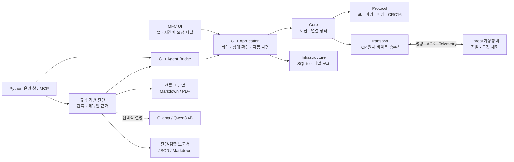
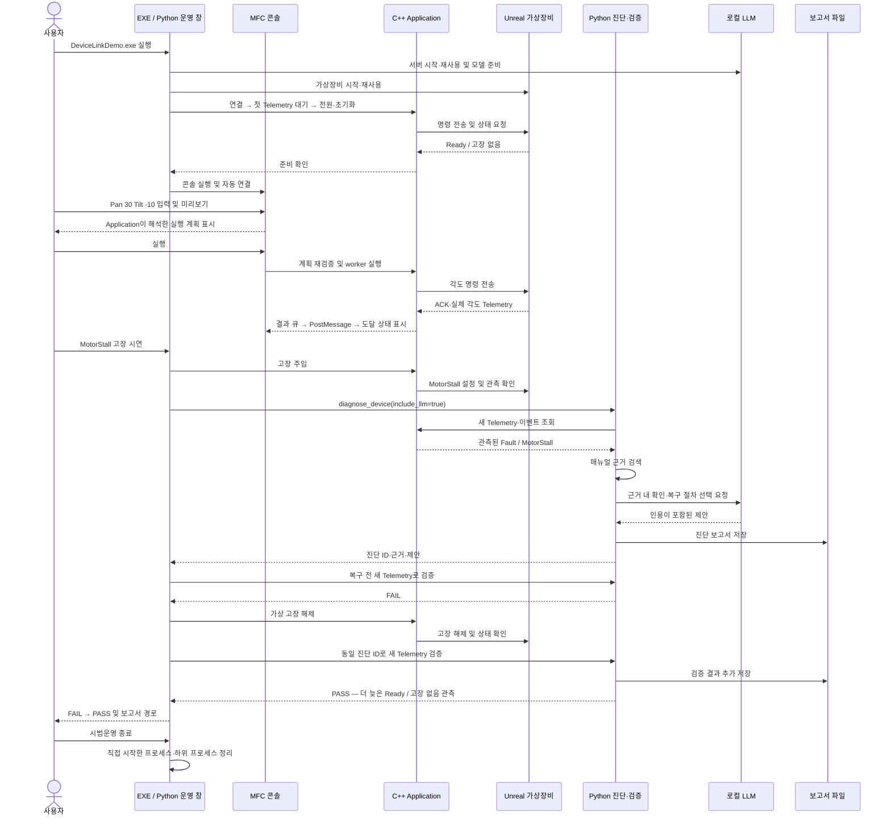

# DeviceLink Studio

**Windows C++20 · MFC · Unreal Engine 5.8 · TCP · SQLite**

가상 EO/IR 장비를 제어하고 통신 장애·고장 복구·자동 시험을 검증하는 SILS-like 테스트베드입니다. 통신 설계, 상태 전이, 멀티스레드 처리와 시험 자동화를 중심으로 구현합니다.

## 주요 기능

- **장비 제어:** 전원·초기화·Pan/Tilt·Scan, 실제 각도·온도·전압 표시
- **통신·복구:** 프레임·CRC16, 송수신 큐, 자동 재접속, Heartbeat 감시
- **자동 시험:** 고장·응답 지연·무응답 주입, 시나리오·Record & Replay, PASS/FAIL 보고서
- **운용 이력:** SQLite 이벤트·알람 저장 및 조회
- **진단:** 새 Telemetry·매뉴얼 근거를 사용하는 규칙 기반 진단, 선택적 로컬 LLM 설명
- **MFC 요청 패널:** 운용·시험/설정·이력/패킷 탭, 제한된 자연어 요청의 미리보기·실행·중지

UI는 Application 서비스를 사용하고, worker 결과는 이벤트 큐와 `PostMessage`를 거쳐 UI 스레드에 전달합니다. Protocol은 패킷을 해석하고 Transport는 원시 바이트만 전송합니다.

## 구조도

주요 호출·데이터 흐름입니다. MFC와 C++ 브리지는 같은 Application 라이브러리를 사용하며, 각각의 실행 프로세스에서 장비에 연결합니다.



MFC 요청 패널은 현재 제어·관측 진단까지 연결되어 있습니다. Python의 매뉴얼·LLM·보고서 기능을 MFC에 연결하는 작업은 진행 중입니다.

## 실행

준비된 이 PC에서는 프로젝트 루트의 **`DeviceLinkDemo.exe`**를 실행합니다. 운영 창이 로컬 LLM·Unreal 가상장비·MFC를 준비하고 장비에 자동 연결합니다.

1. `시범운영 준비 완료`까지 기다립니다.
2. MFC에서 장비를 조작하거나 `현재 상태 확인`, `Pan 30 Tilt -10`을 입력해 **미리보기 → 실행**합니다.
3. 운영 창의 `MotorStall 고장 시연`으로 AI 진단과 복구 전후 FAIL→PASS를 확인합니다.
4. 종료는 운영 창의 `시범운영 종료`를 사용합니다.

### 작업 절차 시퀀스

준비·자연어 운용·고장 시연의 성공 경로입니다. 운영 창은 브리지를 통해, MFC는 프로세스 내부에서 Application을 호출합니다. 장비 명령·조회는 Protocol·Transport를 거칩니다.



3D 화면은 운영 창에서 선택하며 선택값을 저장합니다. 로그·시연 이력·보고서는 `artifacts/demo/`에 기록합니다. **EXE는 프로젝트의 모델·Python·Unreal·빌드 결과를 사용하는 런처이므로 단독 배포본이 아닙니다.**

### 새 PC 또는 재빌드

Windows x64, Visual Studio C++/MFC·Windows SDK·CMake/Ninja, Unreal Engine 5.8, Python 3.11 이상이 필요합니다. 가상장비와 로컬 모델은 아래 사용서에 따라 먼저 준비합니다.

```powershell
python -m venv mcp_server/.venv
.\mcp_server\.venv\Scripts\python.exe -m pip install -r mcp_server/requirements-diagnostics.txt
.\scripts\Setup-LocalDiagnosticLlm.ps1
.\scripts\Build-DemoLauncher.ps1
```

- [Unreal 가상장비 준비](docs/UNREAL_VIRTUAL_DEVICE.md) · [로컬 LLM 설치·설정](docs/LOCAL_LLM_SETUP_KR.md)
- 개별 실행: `run-unreal-virtual-device.bat`, `run-mfc-host.bat`
- 기본 주소: 장비 `127.0.0.1:5000`, Ollama `127.0.0.1:11434`
- 모델·가상환경·실행 파일·PC별 설정·생성 보고서는 Git에 포함하지 않습니다.

## 진단과 현재 범위

`diagnose_device`는 기본적으로 모델을 호출하지 않습니다. AI 설명이 필요할 때만 `include_llm=true`를 지정합니다. 현재 런처는 모델도 자동 준비하며, 모델 시작을 선택 방식으로 바꾸는 작업은 진행 예정입니다.

AI는 **샘플 매뉴얼에 있는 절차를 선택·설명**합니다. 복구 판정은 같은 장비의 더 늦은 Telemetry에서 Ready·고장 없음을 확인한 결과이며, 물리적 수리 성공을 보증하지 않습니다.

MFC의 요청·관측 진단은 구현했으며, **실제 화면 검증과 MFC 내 LLM 설명·매뉴얼 근거·보고서 연결은 미완료**입니다. Unreal 경량화·패키징을 포함한 진행 상황은 [통합 개선 계획](docs/SIMPLIFICATION_MFC_INTEGRATION_PLAN_KR.md)에 기록합니다.

## 검증

2026-10-18 기준 C++ 회귀 시험 **5개**, Python 회귀 시험 **39개**가 통과했습니다. 기존 3D 시연에서는 실제 로컬 모델의 진단과 FAIL→PASS를 확인했습니다. 상세 조건과 한계는 [시연 검증 기록](docs/reports/DEMO_LAUNCHER_VALIDATION_2026-10-17_KR.md)을 참고하세요.

```powershell
ctest --test-dir build-demo --output-on-failure
.\mcp_server\.venv\Scripts\python.exe -m unittest tests.DeviceAgentMcpTests tests.DiagnosticAgentIntegrationTests tests.DemoLauncherTests
```

C++ 시험 실행 파일은 CMake에서 해당 시험 대상을 먼저 빌드해야 합니다. MFC 창의 최종 배치·DPI·실제 입력 검증은 남아 있습니다.

## 문서

[아키텍처](docs/ARCHITECTURE.md) · [시험 절차](docs/TESTING_KR.md) · [MCP·자연어 운용](docs/DEVICE_AGENT_MCP_KR.md) · [로컬 LLM](docs/LOCAL_LLM_SETUP_KR.md) · [개선 계획](docs/SIMPLIFICATION_MFC_INTEGRATION_PLAN_KR.md)
