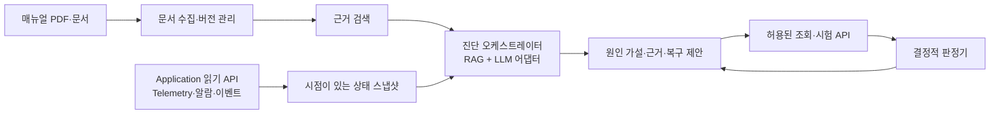

# DeviceLink AI Diagnostic Agent 기획안

## 작업 상태

구현 완료: MCP `get_recent_events`, `get_event_history`, `diagnose_device`, `verify_recovery`, `verify_diagnosis`; 브리지의 장비 ID·Telemetry 관측 시각; SQLite 장비 ID·시간 범위 조회; Markdown 절·PDF 페이지 검색과 문서 해시·인용 ID; 환경 변수로 활성화하는 LangChain 설명 어댑터. `diagnose_device`는 새 Telemetry, 영속 이벤트, 문서 근거를 함께 반환하며 장비 변경 명령을 호출하지 않는다. `verify_recovery`의 PASS는 **현재 Ready/None 상태 확인**만 뜻한다. `verify_diagnosis`는 이전 Fault와 이후 Ready/None 관측을 연결하지만 복구 명령의 인과관계는 주장하지 않는다.

2026-10-17 추가 완료: Ollama 휴대용 런타임 + `qwen3:4b` 로컬 호출, 매뉴얼 절차 목록에 제한한 한국어 제안, JSON Schema·인용·원문 절차 검증, 진단/검증 JSON·Markdown 영속 저장과 재시작 후 조회. 외부 API 키를 사용하지 않는 로컬 설정과 재현 스크립트는 [로컬 LLM 안내](LOCAL_LLM_SETUP_KR.md)에 기록했다. 실제 로컬 모델과 네이티브 브리지를 TCP 시험용 가상장비에 연결한 세 고장 사례가 복구 전 FAIL → 복구 후 PASS를 반환했다. Unreal·물리 장비나 실제 제조사 PDF를 검증한 결과는 아니다.

추가 검증: 실제 DeviceLink Unreal 가상장비와 새 MCP stdio 프로세스, 로컬 LLM을 연결해 짐벌 이동과 세 고장의 FAIL→PASS, 서버 재시작 후 보고서 조회를 확인했다. Windows 한국어 stdio 인코딩을 수정했다. [검증 기록](reports/LOCAL_LLM_UNREAL_VALIDATION_2026-10-17_KR.md)에 현재 채팅의 캐시·연결 문제와 새 서버 프로세스의 통과 범위를 구분했다.

다음 작업: 실제 제조사 매뉴얼을 확보하면 OCR·임베딩 검색 필요성과 절차 추출 품질 평가. 그래픽·카메라 화면 품질과 물리 장비 검증은 별도다. `get_recent_events`는 브리지 세션 메모리의 최대 256건이며, `get_event_history`는 SQLite에 남은 이력을 조회한다. LangChain 설명 실패 시 관측·근거·판정은 유지된다.

## 목표와 범위

장비 이상이 발생하면 **매뉴얼의 절차**와 **실제 장비 관측값**을 함께 제시하고, 가능한 원인과 복구 절차를 근거와 함께 제안한다. 제안 후에는 허용된 상태 조회 API로 장비 상태를 다시 관측하여 결과를 검증한다. 최종 PASS/FAIL은 LLM 문장이 아니라 명시된 조건과 관측값으로 결정한다.

첫 대상은 Unreal 가상 EO/IR 장비의 `MotorStall`, `OverTemperature`, `SensorFailure`, Telemetry 무응답이다. 실제 장비의 안전 진단이나 자동 복구를 보증하는 기능으로 표현하지 않는다.

## 현재 구현과 추가할 기능

| 영역 | 현재 구현 | 보강 목표 |
| --- | --- | --- |
| 문서 | Markdown 절·텍스트 PDF 페이지 검색, 해시·인용·출처, OCR 필요 상태 표시 | 실제 제조사 문서의 검색 품질·OCR·임베딩 필요성 평가 |
| 장비 상태 | Application API의 새 Telemetry, 관측 시각·장비 ID·신선도 확인 | Unreal 및 실제 장비 관측을 이용한 추가 수용 시험 |
| 이력 | Application API를 통한 장비·시간 범위 제한 SQLite 조회 | 더 긴 장애 사례의 근거 범위 평가 |
| 판정 | 같은 장비의 최초 Fault와 이후 Ready/None 관측 비교; 보고서 영속 저장 | 시나리오 보고서와 통합한 운영 화면 검토 |
| 자연어 | 로컬 LLM이 샘플 매뉴얼의 한국어 절차를 선택; 응답 실패 시 관측 결과 유지 | 실제 제조사 문서에 대해 절차 추출·선택 품질 평가 |

현재 RAG는 키워드 검색과 로컬 LLM의 근거 절차 선택으로 구현했다. PDF 텍스트 추출과 LangChain 호출은 구현했고, OCR·임베딩·벡터 인덱스는 도입하지 않았다. 실제 모델의 임의 온도 기준·센서 교체 제안을 확인한 뒤 원문 절차 외 응답을 거부하도록 보강했다.

## 목표 구조

진단 오케스트레이터는 MCP 서버 측의 별도 Python 구성요소로 둔다. LangChain은 문서 분할·검색·LLM 호출의 구현 선택지이며 C++ 계층의 의존성으로 넣지 않는다. 장비 접근은 기존 `DeviceLinkAgentBridge` → `DeviceAgentService` → Application 경계만 사용한다. 로그 조회도 Application 읽기 모델을 통해 제공하고 Python이 SQLite 파일을 직접 열지 않는다. Protocol과 Transport에는 진단 의미를 추가하지 않는다. MFC가 결과를 표시한다면 기존 이벤트 큐와 `PostMessage` 경로를 따른다.

## 진단 흐름과 계약

1. 이상 이벤트 또는 사용자 요청을 받으면 장비 ID, 진단 요청 시각, 관측 시간 범위를 고정한다. `get_telemetry`와 신규 읽기 전용 이벤트 조회 API로 현재 상태와 장애 전후 이력을 얻는다.
2. 상태·fault code·로그 키워드로 해당 장비 모델/매뉴얼 버전의 절을 검색한다. 각 근거에는 문서 ID, 버전, 절 또는 PDF 페이지를 붙인다. 검색 결과가 없으면 근거 부족을 표시한다.
3. LLM은 관측 사실과 문서 근거를 구분하여 **가능한 원인**, **확인 절차**, **복구 제안**을 생성한다. 문서 내용은 참고 데이터로 취급하며 도구 호출 지시로 실행하지 않는다.
4. 상태 확인은 `get_telemetry` 같은 읽기 전용 API로 재조회한다. 복구 동작, fault 주입, 시험 시나리오는 진단 제안만으로 자동 호출하지 않는다. 사용자가 해당 동작을 요청한 경우에만 기존 허용 목록 API와 인자 검증을 거쳐 실행한다.
5. 검증기는 사전에 정한 기대 조건과 새 Telemetry를 비교한다. 예: MotorStall 복구는 `state=Ready`, `fault=None`, 제한 시간 내 새 Telemetry 수신이 모두 충족되어야 PASS다. ACK만 수신하거나 Telemetry가 오래되면 미검증/FAIL로 기록한다.

결과 레코드의 최소 필드: `diagnosis_id`, `device_id`, `requested_at`, `observed_at`, `telemetry_age_ms`, `observations`, `event_window`, `hypotheses`, `evidence_refs`, `recommended_checks`, `actions_taken`, `verification_conditions`, `verification_observations`, `verdict` (`PASS`/`FAIL`/`INCONCLUSIVE`), `limitations`. 원인 가설의 확신도는 관측된 사실이나 시험 PASS와 동일하게 표시하지 않는다.

## 구현 순서

| 단계 | 구현 | 완료 기준 |
| --- | --- | --- |
| 1. 관측 계약 | Application 읽기 전용 이벤트 조회, Telemetry 시각·장비 ID·상태 스냅샷을 브리지/MCP에 노출 | 장비 ID·시간 범위 필터, 조회 상한, 끊김·오래된 데이터 표시 |
| 2. 문서 근거 | PDF/Markdown 수집, 정규화, 청크와 출처 메타데이터, 재색인; 기존 키워드 검색을 기준선으로 유지 | 두 고장 사례에서 정확한 절/페이지가 반환되고 문서 버전 교체가 반영됨 |
| 3. 진단 | 검색기와 LLM 어댑터를 분리하고 구조화된 결과 생성; LangChain 도입 여부는 이 단계에서 결정 | 근거 없는 단정 없이 관측·가설·제안을 분리하고 LLM 오류 시 `INCONCLUSIVE` |
| 4. 검증·보고 | 읽기 전용 재조회, 결정적 판정, 진단 이력·시나리오 보고서 연결 | ACK만 성공한 경우 PASS 금지; timeout·상태 불일치·근거 부재 재현 테스트 통과 |

## 대표 수용 시나리오

| 입력 상황 | 기대 결과 |
| --- | --- |
| `MotorStall` Telemetry와 해당 이벤트, 매뉴얼 절 존재 | MotorStall을 가설로 제시하고 실제 fault 값과 문서 절을 인용; 허용된 복구 절차 제안 |
| 복구 후 새 Telemetry가 `Ready`/`None` | 해당 조건에 한해 복구 검증 PASS |
| ACK는 성공했지만 Telemetry가 `Fault`이거나 응답 없음 | PASS 금지; 관측값과 timeout을 명시 |
| Telemetry 누락 또는 매뉴얼 검색 실패 | 원인 단정 없이 `INCONCLUSIVE`와 부족한 근거 표시 |
| 매뉴얼에 도구 호출 지시 문장이 포함됨 | 인용 데이터로만 처리; 장비 변경 API 호출 없음 |

시연 흐름은 **고장 주입 → Telemetry/이벤트 수집 → 매뉴얼 근거 검색 → 원인·복구 제안 → 사용자가 복구 실행 → 새 Telemetry로 결과 검증 → 근거가 남는 보고서**로 구성한다.
