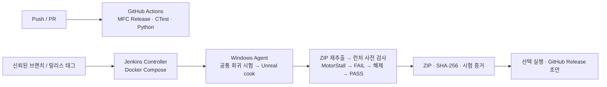

# DeviceLink Studio CI/CD

DeviceLink Studio의 배포에서 중요한 것은 MFC가 빌드되는지와, 배포 ZIP을 푼 뒤 가상 장비의 고장·복구를 재현할 수 있는지다. PR마다 앞부분을 검사하고, 릴리스 후보를 만들 때 Windows 배포물까지 실행한다.

## 검증과 승인 기준

| 단계 | 실패 시 결과 | 남는 증거 |
| --- | --- | --- |
| Windows Release 빌드 및 CTest·Python 회귀 | 빌드 실패로 종료 | 빌드 로그, CTest JUnit XML, Python 실행 로그 |
| Unreal 최소 맵 패키징 | 릴리스 후보 생성 중단 | Unreal AutomationTool 콘솔 로그 |
| ZIP 재추출, Python 새 환경, 런처 사전 검사 | 릴리스 후보 생성 중단 | 사전 검사 결과와 스모크 로그 |
| TCP 스모크 | 장비 기동, 고장 중 FAIL, 복구 후 PASS, 프로세스 종료 중 실패한 항목에서 중단 | JSON 결과, 매뉴얼 인용 보고서, 런처 및 Unreal 로그 |
| 기존 Git 태그와 ZIP SHA-256 확인 | 검증 실패 시 업로드 중단 | 검증한 커밋이 담긴 ZIP, ZIP의 SHA-256 파일 |

CD는 검증된 ZIP과 체크섬을 GitHub Release **초안**까지 전달한다. 공개는 초안의 산출물과 대상 태그를 확인한 후 GitHub에서 실행한다.

## 포트폴리오에서 보여줄 흐름

1. GitHub Actions의 PR 빌드와 테스트 실행을 보여준다.
2. Jenkins에서 동일한 Windows CI와 Unreal 패키징을 실행한다. CTest 결과와 스모크 보고서의 FAIL → PASS를 보여준다.
3. 결과물의 `release.json`에서 커밋과 맵을 확인하고 SHA-256으로 ZIP을 검증한다.
4. 같은 ZIP과 체크섬이 GitHub Release 초안에 첨부됐는지 확인한다.

1~4번의 실제 실행 링크와 산출물을 확보하면 CI/CD 데모가 완성된다. [Jenkins 운영 절차](JENKINS_SETUP_KR.md)

## Windows 로컬 실행 기록

2026-11-15 재확인. Windows에서 CI 스크립트의 CTest 7/7과 Python 50/50이 통과했다. 배포 스크립트로 Unreal 최소 맵을 패키징하고 ZIP을 다시 푼 뒤 런처 사전 검사, MotorStall 복구 전 FAIL과 해제 후 PASS, 종료와 SHA-256 일치를 검증했다. 시험 ZIP은 `620efb0`에 작업 중인 변경을 적용한 사본에서 만들었다. 버전 태그에서 릴리스하려면 이 변경을 포함한 커밋에서 다시 빌드해야 한다.

## Docker·Jenkins 실행 기록

2026-11-15, Docker 컨트롤러와 Java 21 Windows 에이전트를 WebSocket으로 연결했다. [로컬 Jenkins 빌드 #3](http://127.0.0.1:8080/job/DeviceLink-Studio-local-verification/3/)은 8분 40초에 성공했다. CTest 7/7, Python 50/50, ZIP 재추출, MotorStall 해제 전 FAIL과 해제 후 PASS, 정상 종료를 확인했다. Jenkins는 ZIP, SHA-256, JUnit 결과, 실행 로그와 진단 보고서를 보관했다.

처음 두 실행에서 UnrealBuildTool 동시 실행 오류를 관측했다. 에디터와 Win64 타깃을 `Build.bat -WaitMutex`로 각각 빌드한 뒤 AutomationTool에서 cook·stage·archive를 수행해 해결했다.

실행 #3은 작업 중인 변경을 별도 저장소에 커밋한 `029e5cb`를 사용했다. 로컬 Jenkins 작업은 checkout만 해당 검증 저장소로 바꿨다. 실제 GitHub Actions 실행과 원격 태그를 사용한 Release 초안 생성은 아직 검증하지 않았다.
